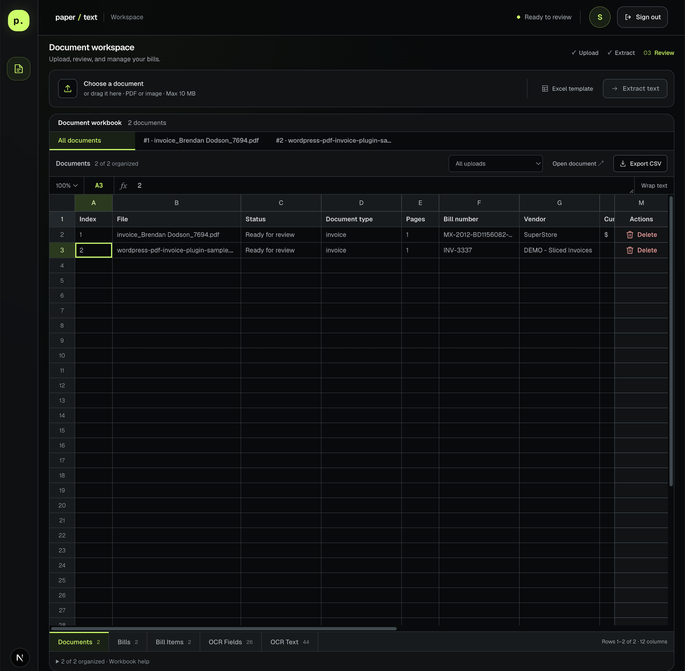
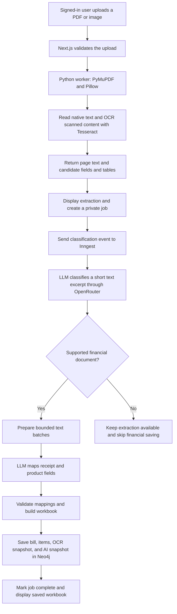
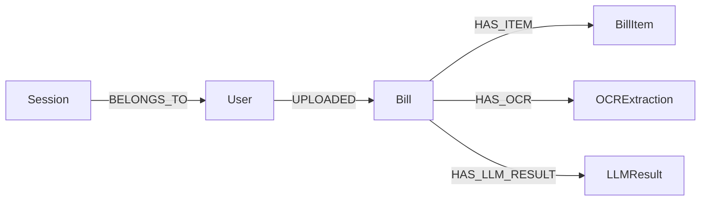

# Paper to Text

A PDF and invoice extraction app built with Next.js, Python, Inngest, OpenRouter, and Neo4j. Upload a PDF or image, extract its text locally, and use an LLM to classify financial documents and organize their contents into reviewable spreadsheet rows. Saved results belong to the signed-in user and are restored from Neo4j when they return.

## Dashboard preview

The dashboard shows the document upload area and a combined workbook for reviewing saved documents, bills, line items, and OCR output.



*Current dashboard captured from the running app, with two organized documents.*

## Features

- Upload and preview PDFs, PNG, JPG/JPEG, WebP, and BMP images.
- Extract existing PDF text with PyMuPDF and recognize scanned content with Tesseract.
- Detect candidate fields and tables while preserving the original extracted text.
- Classify documents and map financial fields using an LLM through OpenRouter.
- Run classification, mapping, and database saving as retryable Inngest steps.
- Review receipt details, products, source fields, tables, and source lines in a workbook.
- Copy text and export TXT, JSON, and financial CSV output.
- Restore saved document history and delete individual bills.
- Sign up, sign in, and manage accounts with Neo4j-backed sessions.

## Tech stack

| Technology | Role |
| --- | --- |
| Next.js 16, React 19, TypeScript | Web interface, API routes, and server-side application logic |
| Tailwind CSS 4 | Styling |
| PDF.js | Browser PDF previews |
| Python and PyMuPDF | PDF reading, text extraction, rendering, and OCR integration |
| Tesseract | Local English OCR for scanned pages and images |
| Pillow | Image decoding, photo orientation, and transparency handling |
| OpenRouter | Access to the configured text-generation LLM |
| Inngest v4 | Background LLM workflow, step retries, and concurrency control |
| Neo4j and the Neo4j JavaScript driver | Graph storage for users, sessions, bills, items, and extraction snapshots |

The current implementation uses Tesseract for OCR. The LLM receives extracted text for classification and financial mapping; direct Gemini or NVIDIA vision OCR is not implemented.

## How the workflow works


*Illustrated workflow in an n8n-style layout. The application runs these background steps in Inngest.*



### 1. Local extraction

`POST /api/extract` checks the user's session, file size, extension, and file signature, then writes the upload to a private temporary directory. Next.js invokes `python/extract.py` using `PYTHON_EXECUTABLE`; a separate Python web server is not required.

PyMuPDF reads usable native text directly. Pages with images, garbled text, or drawn content without readable text trigger OCR as needed. Mixed pages can combine native text and recognized image text. Image uploads are decoded and oriented with Pillow, placed on a PDF page, and processed through the same OCR pipeline.

Python returns page text, extraction methods, candidate fields, tables, and warnings. The upload file is removed after the extraction request. The original PDF or image is not saved in Neo4j.

### 2. LLM processing in Inngest

The server creates an owner-scoped job and stores the full extraction privately on disk. It sends `document/classification.requested` to Inngest with a job ID and a short text sample. The browser polls `/api/classifications/[id]` for progress.

The `classify-document` function runs these steps:

| Step | What happens |
| --- | --- |
| `check-job` | Verify that the job exists, has an upload owner, and is pending. |
| `classify-document-excerpt` | Ask the configured OpenRouter model to classify the document from a sample capped at 2,400 UTF-8 bytes. |
| `plan-financial-mapping` | Prepare bounded batches of extracted fields, table rows, and text lines with source IDs. |
| `llm-map-financial-data-*` | Ask the model to map each batch into receipt and product fields, processing at most two batches at once. |
| `save-financial-csv` | Validate and merge the mappings, build the workbook, and stage the original OCR and AI artifacts locally. |
| `save-bill-to-neo4j` | Normalize supported values and save the graph transaction. Mark the job complete after saving succeeds. |

Supported financial classifications are `invoice`, `receipt`, `bill`, `credit_note`, `purchase_order`, and `bank_statement`. Documents classified as `other` or `unknown` skip financial mapping and saving; their extracted text remains available in the current browser session.

Both classification and mapping use `OPENROUTER_MODEL`. The model is instructed to copy source values, cite source IDs, omit missing or ambiguous fields, and treat document content as untrusted data. Application code validates responses and source references, checks field meanings, and flags arithmetic discrepancies without changing printed amounts.

Mapping input is limited to 5,000 UTF-8 bytes per batch, 24,000 bytes overall, and eight batches. Documents exceeding these limits must be split. These are input byte limits, not token counts. Binary PDFs and page images are not sent to OpenRouter.

The function is configured with two retries and a concurrency limit of two runs. Inngest records successful steps so a later save failure can be retried without repeating completed LLM steps. Model output is still subject to extraction and interpretation errors, so results need review.

## How Neo4j stores data

Neo4j stores document ownership and related records as connected nodes:



| Node | Stored data |
| --- | --- |
| `User` | Account ID, name, email, salted password hash, and account metadata. |
| `Session` | Session token hash and expiry; linked to its user. |
| `Bill` | Document type, source filename, vendor/customer details, amounts, dates, order/shipping identifiers, warnings, and workbook/classification JSON. |
| `BillItem` | A line item's product details, quantities, prices, tax, discounts, and its bill association. |
| `OCRExtraction` | Original extraction JSON: page text, extraction methods, detected fields/tables, available bounding boxes, and warnings. |
| `LLMResult` | Model identity, validated classification and mapping results, merged organization, and generated workbook JSON. |

The graph stores selected fields as queryable properties and full nested outputs as JSON strings. It does not create a graph node for every text line or field. OCR and AI snapshots are kept separately so the original extraction can be compared with the model's interpretation.

The job ID becomes the stable bill ID. Saving uses `MERGE`, uniqueness constraints, and a single graph transaction to prevent duplicate bills or partial child records during retries. Ambiguous numeric values or dates remain available in the original workbook and can produce normalization warnings rather than guessed database values.

Ownership comes from the authenticated session. History and detail endpoints traverse the current user's `UPLOADED` relationships. Deleting a bill removes its items and OCR/AI snapshots; deleting an account also removes its sessions and owned bills. Deleted bill IDs are guarded against recreation by delayed workflow retries.

### Temporary jobs and saved history

- Job files and staged artifacts use `.data/classifications` by default and expire after 24 hours. `CLASSIFICATION_STORE_DIR` can override the directory.
- Successfully saved graph records remain after temporary jobs expire, until explicitly deleted.
- `GET /api/bills` restores the signed-in user's history with pagination.
- `GET /api/bills/[id]` returns the owner's original OCR, AI result, and workbook.
- `POST /api/bills` can retry saving an owned, staged job before it expires.
- Browser spreadsheet edits are not automatically persisted; a refresh restores the originally saved workbook.

No vector index or semantic-search workflow is currently implemented.

## Run locally

You need Node.js 24+, npm, Python 3 with compatible wheels for the pinned packages, Tesseract English language data, a Neo4j database, and an OpenRouter API key/model.

On macOS:

```bash
npm install
brew install tesseract
npm run setup:python
cp .env.example .env.local
```

Copy the environment file only on initial setup; preserve an existing `.env.local`.

Update the placeholders in `.env.local`:

| Variable | Value |
| --- | --- |
| `PYTHON_EXECUTABLE` | Python interpreter path, usually `.venv/bin/python`. |
| `TESSDATA_PREFIX` | Directory containing `eng.traineddata`; commonly `/opt/homebrew/share/tessdata` on Apple Silicon or `/usr/local/share/tessdata` on Intel Macs. |
| `INNGEST_DEV` | `1` for the local Inngest Dev Server. |
| `OPENROUTER_API_KEY` | Your OpenRouter API key. |
| `OPENROUTER_MODEL` | Exact available text-generation model ID in `provider/model` format. |
| `OPENROUTER_APP_NAME` | Application name sent with model requests. |
| `OPENROUTER_APP_URL` | Application URL, such as `http://localhost:3000`. |
| `NEO4J_URI` | Your database connection URI. |
| `NEO4J_USERNAME` | Your database username. |
| `NEO4J_PASSWORD` | Your database password. |
| `NEO4J_DATABASE` | Database name, commonly `neo4j`. |

Keep credentials in `.env.local`, which is ignored by Git. Restart the app after environment changes. Optional overrides and production Inngest placeholders are included in [.env.example](.env.example).

The backend creates uniqueness constraints on first use, so the database account needs permission to create them. Check connectivity with:

```bash
npm run check:neo4j
```

Start the app:

```bash
npm run dev
```

In a second terminal, start the background workflow server:

```bash
npm run dev:inngest
```

Open http://localhost:3000 to sign up and upload a document. Open http://localhost:8288 to inspect Inngest runs and individual steps. The CLI targets the app's `/api/inngest` endpoint on port 3000; adjust its URL if Next.js runs on another port. The first CLI run needs internet access to download the Inngest CLI.

On Windows, create the virtual environment with `py -m venv .venv`, install packages using `.venv/Scripts/python.exe -m pip install -r python/requirements.txt`, and use that interpreter in `PYTHON_EXECUTABLE`. Install Tesseract language data separately and set its directory in `TESSDATA_PREFIX`.

## Project structure

```text
app/                    Pages and API routes
components/             Upload, preview, extraction review, and workbook UI
lib/inngest/            Event client and background workflow functions
lib/server/ai/          OpenRouter calls and model response validation
lib/server/extraction/  Python worker invocation
lib/server/classification/  Temporary job storage and event submission
lib/server/database/    Neo4j driver, node types, and uniqueness constraints
lib/server/bills/       Normalization, graph persistence, and bill APIs
lib/server/auth/        Accounts, password hashing, and sessions
lib/financial-*.ts      Mapping preparation, validation, and workbook generation
python/ocr/             PDF/image reading, Tesseract recognition, field/table detection
python/tests/           Python extraction regression tests
tests/                  JavaScript workflow and persistence tests
scripts/build/          PDF worker setup for install, development, and builds
scripts/database/       Neo4j connectivity and query checks
scripts/datasets/       Example dataset and workbook generation
data/bills/             Example data and workbook schema
```

## Checks

```bash
npm run lint
npx tsc --noEmit
npm run test:python
npm run test:classification
npm run test:auth
npm run test:workbook
npm run test:bills
npm run test:history
npm run build
```

Python tests generate digital, scanned, mixed, malformed, and protected PDFs and test image, field, and table extraction. OCR checks skip when English language data is unavailable. Set `OCR_SAMPLE_PDF` to a local sample path to enable the optional supplied-invoice regression.

JavaScript tests mock external dependencies where needed and do not establish live-model accuracy. If Turbopack's CSS worker cannot bind a port in a restricted environment, use `npm run build -- --webpack` for the production build check.

## Limits and deployment

Uploads are limited to 10 MB, PDFs to 1–20 pages, and still images to 20 million pixels. Extraction has a 120-second worker timeout and allows two active requests per Next.js process. OCR currently uses English language data; complex layouts and handwriting may need correction. The LLM mapping budget is smaller than the upload limit, so a valid upload can still be too large for financial organization.

Deploy to a Node.js host or container that also provides Python, the pinned Python packages, Tesseract language data, and a writable job directory. A static export cannot run this backend. The Python virtual environment must be recreated on the host; Next.js does not bundle it.

In production, disable `INNGEST_DEV`, configure `INNGEST_EVENT_KEY` and `INNGEST_SIGNING_KEY`, and sync `/api/inngest` with Inngest Cloud. Configure the public application URL and, when needed behind a reverse proxy, `AUTH_ORIGIN`. Keep all credentials server-side.

Temporary classification inputs live on the filesystem. Deployments with multiple app instances need a shared job directory accessible to upload and workflow requests, or a different shared job-storage implementation. Larger workloads should move extraction to a persistent worker. Authentication includes seven-day HTTP-only sessions and salted scrypt password hashing; email verification and password recovery are not implemented.

## More documentation

- [Backend layout](lib/server/README.md)
- [API reference](docs/api/API.md)
- [Bill dataset and workbook schema](data/bills/README.md)
- [Environment template](.env.example)
