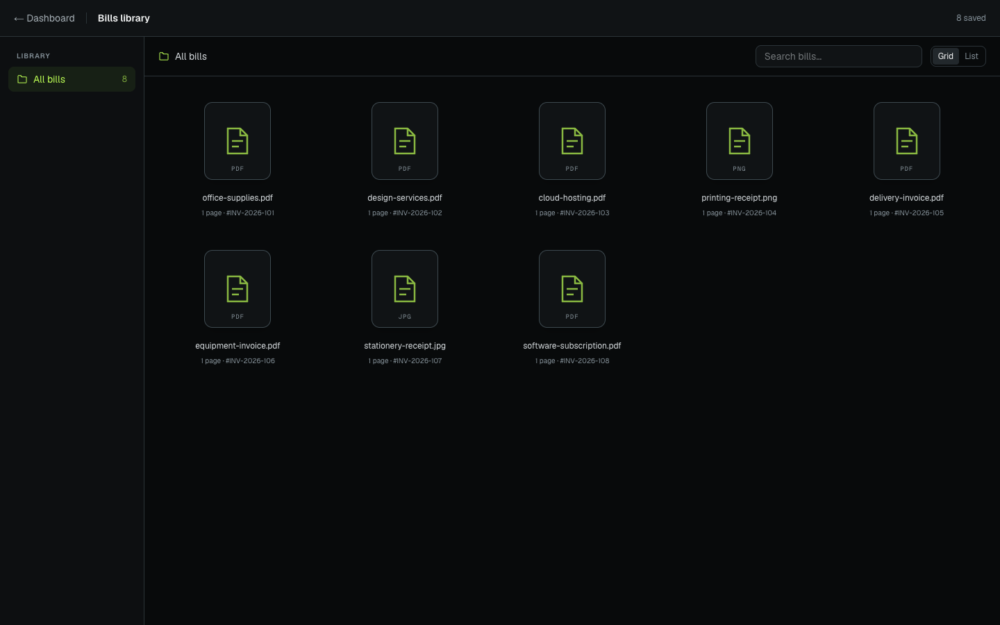

# Paper to Text

Extract text from PDFs and images, organize financial documents in an editable workbook, and ask questions about your saved bills. Browse a searchable bills library, check values against the original OCR evidence, and export financial sheets. Signed-in users can return to saved documents stored in Neo4j.


*Current desktop dashboard with the Document assistant open and eight synthetic sample bills. Screenshots use demonstration data.*



*The Review card opens the bills library. Select a file to inspect its bill data, original OCR JSON, and saved AI output.*

## Features

- Upload and preview PDF, PNG, JPG/JPEG, WebP, and BMP files.
- Read digital PDF text and recognize scanned content with local English OCR.
- Use AI to classify documents and organize bill details and line items.
- Work with **Bills**, **Bill Items**, and **Needs review** views, linked through stable Bill IDs.
- Search bills and items; filter by vendor, currency, bill date, or review status, and choose which columns to display.
- Inspect missing values, ambiguous currency, and validation warnings against the original OCR evidence.
- Export a two-sheet Excel workbook or the visible table as CSV; download TXT and JSON from individual document views.
- Sign in to restore saved financial documents or delete them from your history.
- Repeated uploads of the same file reuse your existing job or saved document.
- Browse saved bills in a searchable library with grid/list views and paginated loading.
- Open dedicated document pages with **Bill & OCR**, **Original OCR JSON**, and **AI output** views.
- Ask the **Document assistant** about saved bills, with expandable filename/page evidence for sourced answers. Simple counts, filename lists, and totals use saved database records.
- Generate document and question embeddings locally with Nomic; answer generation uses the configured OpenRouter model.
- Keep workbook edits, filters, selected cells, scroll position, and library state while navigating within the same browser tab.

**Stack:** Next.js 16 · React 19 · TypeScript · Python · PyMuPDF · Tesseract · Nomic embeddings · OpenRouter · Inngest · Neo4j.

## Workspace layout

The dashboard at `/workspace/dashboard` uses one compact header for branding, the embedding demo, help, profile, sign-out, and the Excel template download. Three workflow cards sit in a single row above the workbook on wider screens and stack on small screens:

| Card | Controls and behavior |
| --- | --- |
| **Upload** | Choose or drag in a PDF or image. Shows the selected filename and size, with a **Preview** action. |
| **Extract** | **Extract text** starts processing. The card shows whether a file is ready, text is being extracted, or data is being organized. |
| **Review** | Shows the number of ready bills and opens the saved-file library at `/workspace/documents`. |

The workbook spans the page width. **All bills** combines the loaded records; pending or unsaved uploads can have temporary document tabs. Saved files open on dedicated document pages through the library or **Open bill & source**. The combined workbook has three views:

| View | What it contains |
| --- | --- |
| **Bills** | One row per uploaded document, combining bill details with optional processing and storage information. Pending, failed, and unsupported uploads remain visible here. |
| **Bill Items** | One row per product or service, linked to its parent bill by **Bill ID**. |
| **Needs review** | A filtered view of the same bill rows with outstanding checks. Editing a value here updates the corresponding bill. |

The bills library offers filename/bill-number search, grid and list views, and **Load more files**. Individual pages at `/workspace/documents/[id]` show the bill reviewer, original OCR JSON, and saved AI output. Original upload files are not retained; source views show saved extracted text and data. On small screens, the dashboard scrolls vertically and wide tables scroll horizontally.

The floating **Document assistant** on the dashboard searches the signed-in user's saved bills. Closing and reopening it preserves the conversation in that tab; **New chat** or a browser reload clears it.

## Quick start

### 1. Prerequisites

Install Git, Node.js 24+ with npm, and Python 3 with wheels available for the [pinned packages](python/requirements.txt). You also need a running Neo4j database and an OpenRouter API key with access to a text-generation model.

```bash
git clone https://github.com/soumyadipmandal19/ai-invoice-ocr.git
cd ai-invoice-ocr
```

### 2. Install for your operating system

Run the commands for your OS from the project root. Copy `.env.example` only on initial setup; keep an existing `.env.local`.

`python/requirements.txt` contains both OCR and local embedding dependencies. Model weights are downloaded separately; see [local embedding setup](docs/guides/embeddings.md).

#### macOS — Terminal

Install [Homebrew](https://brew.sh/) first if needed.

```bash
brew install tesseract
npm install
npm run setup:python
cp .env.example .env.local
brew --prefix
```

In `.env.local`, set `PYTHON_EXECUTABLE=.venv/bin/python`. Set `TESSDATA_PREFIX` to the Homebrew prefix printed above plus `/share/tessdata` (usually `/opt/homebrew/share/tessdata` or `/usr/local/share/tessdata`).

#### Windows — PowerShell

Install Tesseract with English language data using the Windows installer linked in the [Tesseract installation guide](https://tesseract-ocr.github.io/tessdoc/Installation.html#windows).

```powershell
npm install
py -m venv .venv
.\.venv\Scripts\python.exe -m pip install -r python/requirements.txt
Copy-Item .env.example .env.local
```

Set these values in `.env.local`, adjusting the Tesseract path to your installation:

```dotenv
PYTHON_EXECUTABLE=.venv/Scripts/python.exe
TESSDATA_PREFIX="C:/Program Files/Tesseract-OCR/tessdata"
```

Use the explicit commands above: `npm run setup:python` assumes a macOS/Linux virtual environment layout.

#### Linux — Ubuntu/Debian

```bash
sudo apt update
sudo apt install python3 python3-venv tesseract-ocr tesseract-ocr-eng
npm install
npm run setup:python
cp .env.example .env.local
dpkg -L tesseract-ocr-eng
```

Locate `eng.traineddata` in the package listing. In `.env.local`, set `PYTHON_EXECUTABLE=.venv/bin/python` and set `TESSDATA_PREFIX` to that file's containing directory. For other distributions, install equivalent Python, virtual environment, and [Tesseract English data packages](https://tesseract-ocr.github.io/tessdoc/Installation.html).

### 3. Configure services

Edit `.env.local` after setting the Python and OCR paths above:

| Setting | What to enter |
| --- | --- |
| `OPENROUTER_API_KEY` | Your OpenRouter API key. |
| `OPENROUTER_MODEL` | An available text-generation model ID in `provider/model` format. |
| `NEO4J_URI`, `NEO4J_USERNAME`, `NEO4J_PASSWORD` | Your Neo4j connection details. |
| `NEO4J_DATABASE` | Your database name, commonly `neo4j`. |
| `INNGEST_DEV` | Keep `1` for local development. |

Replace the app name placeholder in `OPENROUTER_APP_NAME` and keep `OPENROUTER_APP_URL=http://localhost:3000` locally. The database user needs permission to create uniqueness constraints. `TESSDATA_PREFIX` must contain `eng.traineddata`.

Keep credentials in `.env.local`, which Git ignores. See [.env.example](.env.example) for all settings. Restart the app after configuration changes.

#### Enable document search and chat

Download the local embedding model after installing the Python requirements:

```bash
npm run download:embeddings
```

Set these additional values in `.env.local`:

```dotenv
EMBEDDINGS_ENABLED=1
EMBEDDING_MODEL_PATH=.data/models/nomic
EMBEDDING_DEVICE=cpu
```

This uses local `nomic-embed-text-v1.5` inference with 768-dimensional vectors. No Nomic API key is needed. Document indexing runs through Inngest after financial saving; chat questions run directly in the request. `OPENROUTER_CHAT_MODEL` optionally overrides `OPENROUTER_MODEL` for answers. See [local embeddings](docs/guides/embeddings.md) for Windows commands, existing-document indexing, and status checks.

### 4. Start the app

Check the database connection first:

```bash
npm run check:neo4j
```

- **Connected:** prints `Neo4j Aura connected: credentials and database query verified.` Continue below.
- **Failed:** prints `Neo4j check failed.` Check that Neo4j is running, the `NEO4J_*` settings in `.env.local` are correct, and the database is reachable. Rerun the check until it succeeds.

`npm run dev` can start even when Neo4j is unavailable, but database-dependent actions such as sign-in and saving documents will fail. Starting the app does not confirm a database connection.

After the check succeeds, start Next.js:

```bash
npm run dev
```

In a second terminal, from the project root:

```bash
npm run dev:inngest
```

Open [the app](http://localhost:3000). After sign-in, it redirects to `/workspace/dashboard`; the bills library is at `/workspace/documents`. Inspect background runs in [Inngest](http://localhost:8288). The first Inngest launch downloads its CLI. If Next.js uses a different port, update the target URL in the `dev:inngest` command in `package.json`.

## Usage

### Upload and extract

1. Sign up or sign in. Saved financial documents load into the workspace automatically.
2. Choose a file in the **Upload** card or drag it onto the workflow cards. Use **Preview** to inspect the selected file.
3. Select **Extract text**. Review extracted text while AI classification and financial mapping finish.
4. Review the combined **All bills** workbook. Select **Review** to browse saved files, or select a workbook row and choose **Open bill & source** to inspect that document.

After successful extraction, or when a duplicate upload opens an existing document, the Upload card clears its selected file and preview so you can choose the next document. The extracted result remains in the workspace. If extraction fails, the file stays selected for retry.

### Find and edit financial data

The default Bills columns show bill number, date, vendor, currency, subtotal, tax, total, review status, and filename. Bill Items starts with bill number, product or service, quantity, unit price, discount, tax, line total, and currency. Both use readable column names and the same spreadsheet controls.

- **Search** matches filenames, bill numbers, vendors, and item data.
- **Filters** reveals vendor, currency, review-status, and bill-date controls. Use **Clear filters** to reset them. Date filtering includes only unambiguous `YYYY-MM-DD` bill dates.
- **Columns** lets you select individual fields, restore **Essential** columns, or **Show all**. Additional fields include Bill ID, processing status, page count, storage state, and review notes.
- **Double-click** a financial cell to edit it, or use the selected-cell value bar. The inline editor stays within the cell without expanding the row. **F2** starts editing, **Enter** saves, and **Escape** cancels. Bill IDs and source metadata are read-only. Pending uploads and unavailable legacy fields cannot be edited.
- **Needs review** highlights missing or uncertain values in amber. A printed `$` can remain visible while its exact currency code is unconfirmed.
- **Mark reviewed** is available when the selected bill's missing values and validation warnings have been resolved. Review status belongs to the bill, including when this action is used from Bill Items.

Select a saved bill row and use **Delete** to remove that bill and its related stored data after confirmation.

### Inspect source evidence and review notes

Select a row and choose **Open bill & source**, or open a saved file from the bills library. **Source evidence & standardized values** shows extracted or edited values beside unambiguous standard forms and the original, read-only OCR text. Detailed checks explain missing values, date ambiguity, currency uncertainty, and other validation warnings. Older saved bills without a complete OCR snapshot retain their available source sheets.

The **Review notes** column contains short checklists such as `Currency unconfirmed; Check bill date`. It shows up to four distinct summaries and a count of additional checks. Complete explanations remain in the bill's review panels. Item review notes contain item-specific checks rather than repeating every bill warning. The generic AI disclaimer is omitted from exported Notes; user-entered notes are retained.

Individual document views also provide bill data, fields and tables, readable text, original text, and JSON output.

### Ask questions about your bills

Open the floating chat button on the dashboard and ask, for example:

- “How many bills do I have?”
- “List my uploaded filenames.”
- “What is my total spending?”
- “What payment terms are listed on invoice 123?”
- “Summarize all my documents.”

Simple counts, filename lists, and totals read owned database records directly, even before text indexing is ready. Totals keep currencies separate and disclose excluded amounts or unknown currencies; they do not establish payment status.

For document questions, the server embeds the question locally, compares it with the user's indexed OCR chunks in Neo4j, and sends up to six relevant excerpts to the configured OpenRouter answer model. Expand a source card to inspect the exact excerpt and page. Naming an invoice or filename can narrow the scope, and short follow-ups can retain that document context.

Complete summaries use all indexed chunks within a 40-chunk/40,000-character limit. Missing indexing or oversized scopes return an explanation. Filtered calculations and complete ranked comparisons are not implemented. See [document chatbot](docs/guides/chat.md) for configuration and limits.

### Export and return to saved results

| Action | Output |
| --- | --- |
| **Export Excel** | Downloads `bills-workbook.xlsx` with **Bills** and **Bill Items** sheets, matching Bill IDs, all available columns, and current browser edits. Both sheets respect the active bill filters. From Needs review, export includes only those bills and their items. Headers are frozen and filterable. |
| **CSV** | Downloads the current table with its visible columns, filters, and browser edits. |
| Document downloads | TXT and JSON output, plus individual financial-sheet CSV downloads. |

Excel preserves values as text to retain leading zeros, printed number formats, and ambiguous dates. Amounts are not converted to numeric Excel cells; convert verified values before using spreadsheet calculations. Existing downloads are not changed when data or review notes are updated—export again for a new copy.

Saved financial documents reload for the signed-in account. Workbook edits, filters, selection, and scroll position survive client navigation between the dashboard and document pages in the same tab. Browser corrections and **Mark reviewed** changes are not automatically saved to Neo4j; export them before refreshing or closing the tab. Refreshing restores the original saved result, and signing out clears the in-memory workspace state.

## Limits and data handling

- **Uploads:** up to 10 MB, 1–20 PDF pages, or 20 million pixels per image. Extraction times out after 120 seconds.
- **Accuracy:** English OCR; complex layouts and handwriting may need correction. Review AI results before using them.
- **AI processing:** extracted text is sent to OpenRouter. Original PDFs and images are not sent. Mapping has a separate text budget, so larger documents may need splitting.
- **Chat:** document and question embeddings run locally. Retrieved OCR excerpts, the question, and bounded conversation history go to the configured OpenRouter answer provider. Chat questions and answers are not persisted by the application. Source-reference checks do not guarantee factual correctness.
- **Storage:** uploaded files are removed after extraction. Temporary jobs expire after 24 hours; saved OCR text and AI results remain in Neo4j until deleted. Unsupported financial classifications keep text available only in the current browser session.

## Documentation

- [Documentation index](docs/README.md)
- [Architecture and AI workflow](docs/architecture/overview.md)
- [Database and saved history](docs/architecture/database.md)
- [Development, checks, and project structure](docs/guides/development.md)
- [Deployment](docs/guides/deployment.md)
- [Local embeddings](docs/guides/embeddings.md)
- [Bills library and navigation state](docs/guides/documents.md)
- [Document chatbot](docs/guides/chat.md)
- [Backend layout](lib/server/README.md) · [API reference](docs/api/API.md)
- [Dataset and schema](data/bills/README.md) · [Environment template](.env.example)
