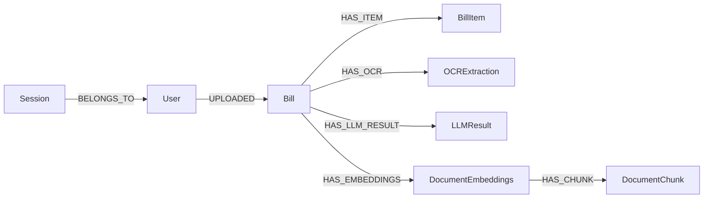

# Database and saved history

[Back to README](../../README.md)

Neo4j stores document ownership and related records as connected nodes:

| Node | Stored data |
| --- | --- |
| `User` | Account ID, name, email, salted password hash, and account metadata. |
| `Session` | Session token hash and expiry; linked to its user. |
| `Bill` | Document type, source filename, vendor/customer details, amounts, dates, order/shipping identifiers, warnings, and workbook/classification JSON. |
| `BillItem` | A line item's product details, quantities, prices, tax, discounts, and its bill association. |
| `OCRExtraction` | Original extraction JSON: page text, extraction methods, detected fields/tables, available bounding boxes, and warnings. |
| `LLMResult` | Model identity, validated classification and mapping results, merged organization, and generated workbook JSON. |
| `DocumentEmbeddings` | One grouping node per bill: model, dimensions, profile, processing status, chunk count, request tracking, fingerprint, and timestamps. |
| `DocumentChunk` | A section of original OCR text, its page/position, text hash, bill/owner/group IDs, and the 768-number embedding vector. |

The graph stores selected fields as queryable properties and full nested outputs as JSON strings. It does not create a graph node for every text line or field. OCR and AI snapshots are kept separately so the original extraction can be compared with the model's interpretation.

The job ID becomes the stable bill ID. Saving uses `MERGE`, uniqueness constraints, and a single graph transaction to prevent duplicate bills or partial child records during retries. Ambiguous numeric values or dates remain available in the original workbook and can produce normalization warnings rather than guessed database values.

Ownership comes from the authenticated session. History and detail endpoints traverse the current user's `UPLOADED` relationships. Deleting a bill removes its items and OCR/AI snapshots; deleting an account also removes its sessions and owned bills. Deleted bill IDs are guarded against recreation by delayed workflow retries.

### Temporary jobs and saved history

- Job files and staged artifacts use `.data/classifications` by default and expire after 24 hours. `CLASSIFICATION_STORE_DIR` can override the directory.
- Successfully saved graph records remain after temporary jobs expire, until explicitly deleted.
- `GET /api/bills` restores the signed-in user's history with pagination.
- `GET /api/bills/[id]` returns the owner's original OCR, AI result, and workbook.
- `POST /api/bills` can retry saving an owned, staged job before it expires.
- Browser spreadsheet edits are not automatically persisted; a refresh restores the originally saved workbook.

The cosine vector index `paper_nomic_chunks` indexes `DocumentChunk.embedding`.
The [document chatbot](../guides/chat.md) performs owner-scoped exact similarity
search over these chunks and generates source-referenced answers. See
[local embeddings](../guides/embeddings.md) for setup, limits, and existing-data
migration. Bill/account deletion removes embedding groups and their chunks, also
handling older direct Bill-to-chunk links.

## Duplicate upload reservations

`(User)-[:HAS_UPLOAD]->(DocumentUpload)` reserves a SHA-256 fingerprint of the
file bytes and owner before OCR starts. A unique `uploadKey` and an owner write
lock prevent concurrent requests from creating separate jobs for identical files.
The reservation stores the job ID and creation time, without storing the original
file. Saved bills remain reusable after local classification jobs expire.

Abandoned extraction reservations can be retried after five minutes. Failed jobs
without staged financial output can be retried; staged output retains its job ID
for save retries. A financial save must still own its upload reservation, so a
superseded workflow cannot create a duplicate bill later. Deleting a bill removes
its reservation; deleting an account removes all its reservations.

Detection applies to uploads made after this feature is enabled. Existing saved
files cannot be fingerprinted retroactively because their original bytes were
removed. Byte-different copies of the same invoice remain separate documents.
