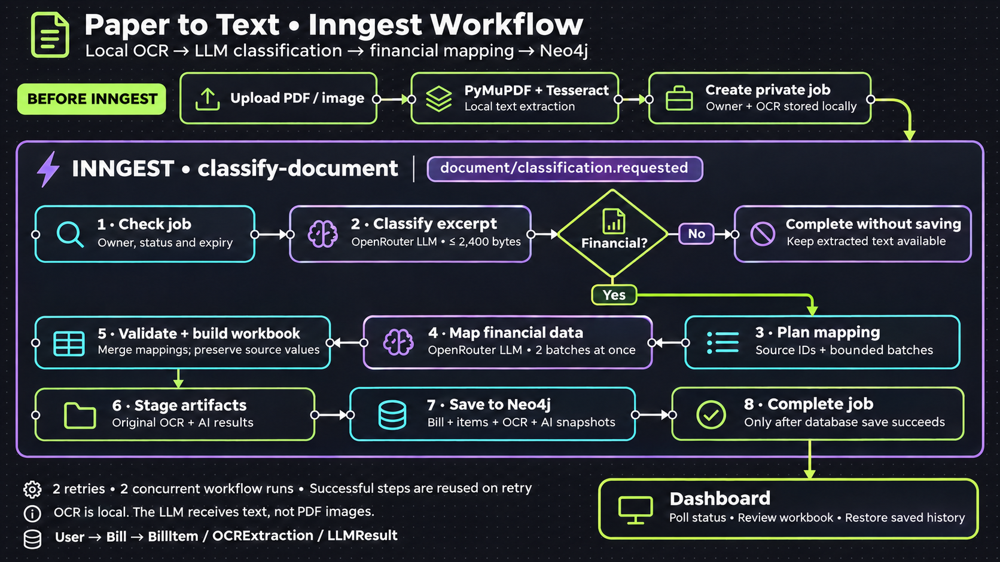
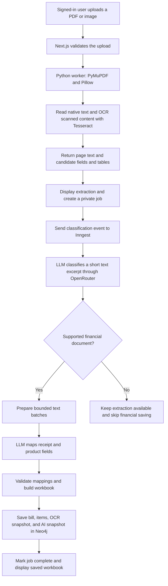

# Processing architecture

[Back to README](../../README.md)

*Background processing runs in Inngest.*

### 1. Local extraction

`POST /api/extract` checks the user's session, file size, extension, and file signature, then writes the upload to a private temporary directory. Next.js invokes `python/extract.py` using `PYTHON_EXECUTABLE`; a separate Python web server is not required.

PyMuPDF reads usable native text directly. Pages with images, garbled text, or drawn content without readable text trigger OCR as needed. Mixed pages can combine native text and recognized image text. Image uploads are decoded and oriented with Pillow, placed on a PDF page, and processed through the same OCR pipeline.

Currency extraction also checks legacy fonts that draw a currency symbol at a
different character code. A verified rendered-glyph fingerprint recovers known
rupee symbols encoded as backticks; font names alone never establish a currency.
Unrecognized standalone backticks next to amounts can trigger targeted visual OCR
at 300 and 400 DPI. Both readings must agree on a supported currency symbol and
the exact original amount before changing the symbol. At most four regions per
page are attempted, with a one-million-pixel limit per rendered crop. Ambiguous
matches, rotated-page crops, and failed supplementary OCR preserve native text
and surface a review warning. Text and word coordinates are corrected together
before field/table extraction. Ordinary backticks are not globally replaced.

This recovery applies during extraction. Existing saved OCR/AI snapshots remain
unchanged, and duplicate uploads still open the saved result rather than rerunning
extraction. `Rs.` alone remains ambiguous; a verified `₹` establishes INR and is
compatible with the shared rupee abbreviation.

Python returns page text, extraction methods, candidate fields, tables, and warnings. The upload file is removed after the extraction request. The original PDF or image is not saved in Neo4j.

### 2. LLM processing in Inngest

The server creates an owner-scoped job and stores the full extraction privately on disk. It sends `document/classification.requested` to Inngest with a job ID and a short text sample. The browser polls `/api/classifications/[id]` for progress.

The `classify-document` function runs these steps:

| Step | What happens |
| --- | --- |
| `check-job` | Verify that the job exists, has an upload owner, and is pending. |
| `classify-document-excerpt` | Ask the configured OpenRouter model to classify the document from a sample capped at 2,400 UTF-8 bytes. |
| `plan-financial-mapping` | Prepare bounded batches of extracted fields, table rows, and text lines with source IDs. |
| `llm-map-financial-data-*` | Ask the model to map each batch into receipt and product fields, processing at most two batches at once. |
| `save-financial-csv` | Validate and merge the mappings, build the workbook, and stage the original OCR and AI artifacts locally. |
| `save-bill-to-neo4j` | Normalize supported values and save the graph transaction. Mark the job complete after saving succeeds. |

Supported financial classifications are `invoice`, `receipt`, `bill`, `credit_note`, `purchase_order`, and `bank_statement`. Documents classified as `other` or `unknown` skip financial mapping and saving; their extracted text remains available in the current browser session.

Both classification and mapping use `OPENROUTER_MODEL`. The model is instructed to copy source values, cite source IDs, omit missing or ambiguous fields, and treat document content as untrusted data. Application code validates responses and source references, checks field meanings, and flags arithmetic discrepancies without changing printed amounts.

Mapping input is limited to 5,000 UTF-8 bytes per batch, 24,000 bytes overall, and eight batches. Documents exceeding these limits must be split. These are input byte limits, not token counts. Binary PDFs and page images are not sent to OpenRouter.

The function is configured with two retries and a concurrency limit of two runs. Inngest records successful steps so a later save failure can be retried without repeating completed LLM steps. Model output is still subject to extraction and interpretation errors, so results need review.

See [database storage](database.md) for persistence and ownership.
